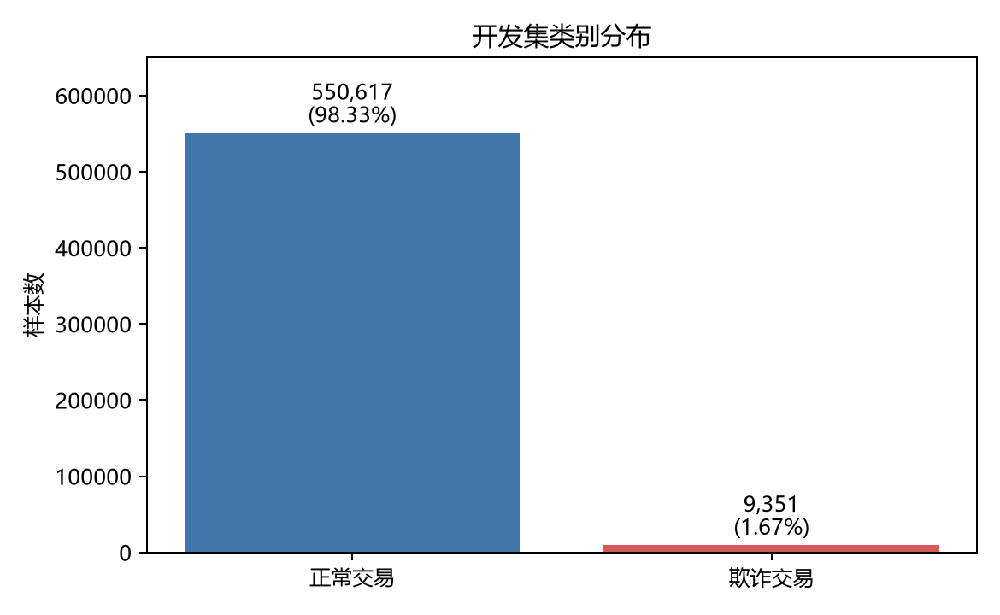
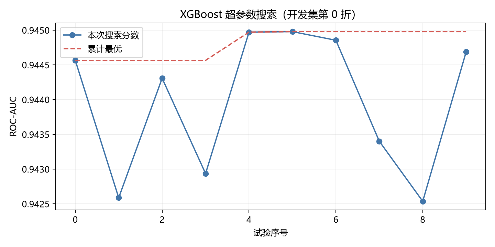
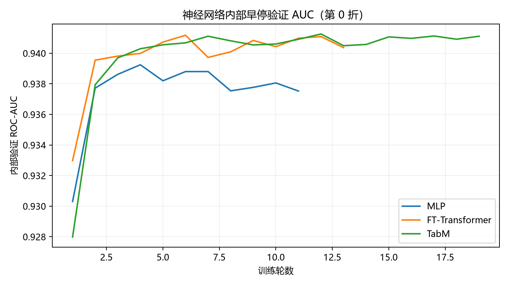
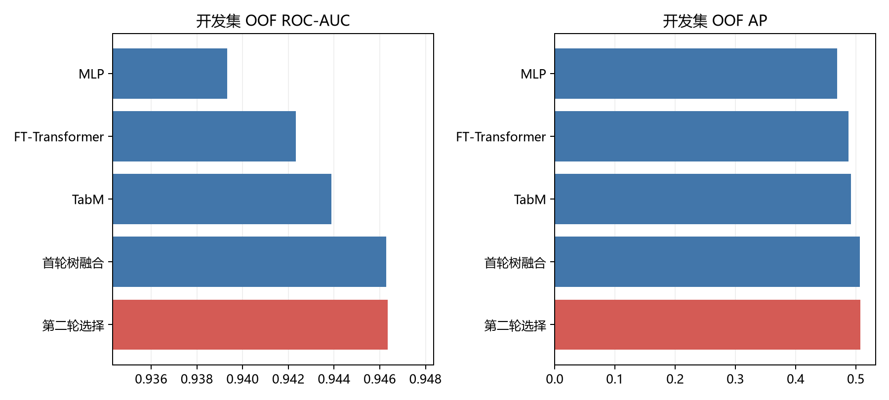
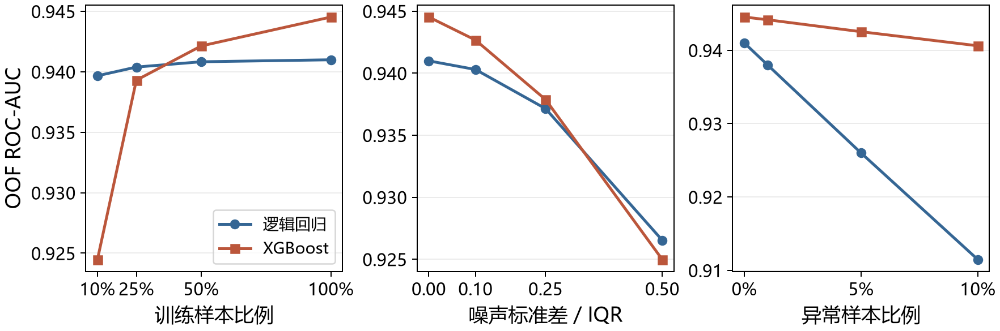

# 信用卡欺诈预测分类实验报告

| 姓名 / 学号 | 具体任务及贡献 |
| --- | --- |
| 胡懿晨 / 2452273 |  |
| 董熙远 / 2452060 |  |
| 张哲豪 / 2453780 |  |
| 张梓桑 / 2451982 |  |

## 一 课题综述

### 1 课题简介

本项目参加 Kaggle Playground Series S6E11 信用卡欺诈预测比赛，并完成机器学习课程项目 2 的分类实验。模型根据交易金额、账户状态、商户风险、验证方式及行为标记等特征，预测交易为欺诈的概率。我们在统一数据划分下比较逻辑回归、决策树、XGBoost 与 CatBoost，再通过参数优化、特征工程及融合选择提升预测表现。首轮按开发集选择的方案为 XGBoost 目标编码 × 0.7 + CatBoost 基线 × 0.3，独立测试集 ROC-AUC 为 0.952060。

第二轮进一步加入 MLP、FT-Transformer 和 TabM，比较神经网络与树模型的互补性。本轮所选方案的开发集 OOF AUC 为 0.946356；本轮沿用开发集选型，首轮独立测试成绩保留。

### 2 课题目标

比赛以 ROC-AUC 为主要指标；课程实验同时考察类别不平衡下的精确率、召回率和 F1，分析不同分类方法的适用条件。实验目标包括可复现的数据预处理、公平的模型比较、至少一种模型的优化，以及真实类别与预测类别的可视化分析。

### 3 课题数据集

数据来自 Kaggle 官方比赛，共 699,960 条有标签样本和 299,984 条比赛测试样本。去除 id 与 is_fraud 后有 24 个输入特征，包括 13 个数值特征、5 个字符串类别特征和 6 个布尔标记。id 只用于对应样本，不参与训练。比赛测试标签不公开，所有本地评估均来自官方训练数据的内部划分。

开发集欺诈比例为 1.6699%，约每 60 笔交易出现一笔欺诈；全部预测为正常即可取得 98.3301% 的准确率，却完全无法发现欺诈。因此准确率作为辅助指标，不能单独用于选择模型。

图 1 开发集类别分布

## 二 实验设计与结果

### 1 数据准备与预处理

以随机种子 20261121 按标签分层预留 20% 独立测试数据，即 139,992 条；其余 559,968 条作为开发集。开发集固定为 3 折，所有模型共用划分。每次用两折训练、一折预测，汇总得到每条开发样本的折外预测。划分与数据指纹保存在 artifacts/splits.parquet 及配套 JSON 中。

开发集共有 0 个缺失值，未发现完全相同的重复特征行。逻辑回归使用数值列中位数填补、标准化和类别独热编码；决策树及 XGBoost 保留数值尺度，对字符串类别进行独热编码；CatBoost 原生处理类别特征。填补、缩放和类别词表均只在对应训练数据上拟合，验证集的新类别采用未知值处理。金额等长尾变量保留原值，避免把可能有用的欺诈信号当作异常删除。

数值分布比较与类别欺诈比例仅用于开发集探索。布尔标记在模型中按 0/1 使用。训练开发集与比赛测试集的数值 KS 统计量较小，本轮未发现明显的单变量分布偏移；这一检查不等同于证明联合分布相同。

图 2 开发集中关联较强的数值特征分布

CVV 重试次数、商户风险和交易速度与标签的关联较明显；单变量相关性反映边际关系，不能解释全部交互效应，也不构成因果结论。类别特征中不同验证方式和商户类型对应的欺诈比例也存在差异。

### 2 模型搭建

| 方法 | 基本原理 | 关键设置 |
| --- | --- | --- |
| 逻辑回归 | 线性特征组合经 Sigmoid 映射为概率，使用 L2 正则化 | C=1，最多 1000 次迭代 |
| 决策树 | 递归划分特征空间，在叶节点形成分类概率 | 最大深度 8，叶节点至少 100 样本，类别平衡权重 |
| XGBoost | 逐轮拟合损失梯度，组合多棵树以刻画非线性和交互 | GPU hist，基线深度 5，学习率 0.04，L2=10 |
| CatBoost | 梯度提升树，原生支持类别特征并施加正则化 | GPU，深度 6，学习率 0.04，L2=8 |

逻辑回归与决策树代表不同的建模思路，满足课程对至少两类传统分类方法的要求；两种树提升方法用于进一步争取比赛成绩。CPU 用于轻量对照模型，主要树提升训练均强制使用 GPU。

### 3 模型训练与评估

运行环境为 Windows、Python 3.12.13、NVIDIA GeForce RTX 4060 Laptop GPU, 8188 MiB, 581.08。主要依赖版本为 scikit-learn 1.9.1、XGBoost 3.4.1 和 CatBoost 1.2.10。GPU 自检实际完成两类模型的训练与预测，并核对训练设备；完整版本锁定在 requirements-lock.txt。

树提升训练在每个外层训练折内部再分出 10% 用于早停，随后按选定轮数重训整个外层训练折。外层验证折不参与早停。主指标 ROC-AUC 衡量风险排序；Average Precision 总结精确率召回率曲线，对少数欺诈类别更敏感；同时记录准确率、Precision、Recall、F1 和对数损失。分类阈值在开发集折外预测上按 F1 最大化选择，并原样用于独立测试集。

| 实验 | OOF AUC | 折间标准差 | OOF AP | 耗时 秒 |
| --- | --- | --- | --- | --- |
| XGBoost 目标编码 | 0.945699 | 0.000889 | 0.503722 | 81.2 |
| XGBoost 调参 | 0.944820 | 0.000259 | 0.498889 | 50.8 |
| XGBoost 基线 | 0.944525 | 0.000391 | 0.496685 | 47.8 |
| XGBoost 特征工程 | 0.944523 | 0.000294 | 0.497109 | 55.6 |
| CatBoost 基线 | 0.943971 | 0.000663 | 0.496205 | 528.6 |
| 逻辑回归 | 0.940992 | 0.000473 | 0.484816 | 17.2 |
| 决策树 | 0.899257 | 0.002664 | 0.300182 | 30.7 |

表中 OOF 成绩用于模型开发，参数搜索和融合权重也在开发集上选择，因此最优方案的 OOF 成绩存在选择偏差。独立测试集在方案冻结后用于最终评估，结果如下；测试结果不反向修改本轮选型、权重或阈值。

OOF 每折模型使用开发集的三分之二训练，最终测试模型使用完整开发集训练，轮数固定为交叉验证所选轮数的中位数。因此两阶段分数的差异同时包含训练样本量和抽样差异，应在相同阶段内比较不同方法。

| 实验 | 测试 AUC | 测试 AP | Precision | Recall | F1 |
| --- | --- | --- | --- | --- | --- |
| XGBoost 目标编码 | 0.9519 | 0.5338 | 0.5292 | 0.5073 | 0.5180 |
| XGBoost 调参 | 0.9504 | 0.5221 | 0.5617 | 0.4692 | 0.5113 |
| XGBoost 基线 | 0.9503 | 0.5238 | 0.5492 | 0.4825 | 0.5137 |
| XGBoost 特征工程 | 0.9503 | 0.5250 | 0.5582 | 0.4803 | 0.5163 |
| CatBoost 基线 | 0.9489 | 0.5224 | 0.5591 | 0.4675 | 0.5092 |
| 逻辑回归 | 0.9455 | 0.5051 | 0.5357 | 0.4718 | 0.5017 |
| 决策树 | 0.9111 | 0.3126 | 0.4173 | 0.3216 | 0.3633 |
| 最终选择 | 0.9521 | 0.5359 | 0.5394 | 0.5034 | 0.5208 |

### 4 结果可视化与模型对比

图 3 开发集与独立测试集性能对比

逻辑回归提供了较强的线性基准，说明部分风险因素可以通过近似可加的关系解释。单棵决策树受到分段划分和有限复杂度的约束，排序信息较粗。树提升模型通过多轮弱学习器组合表达细粒度非线性关系，其收益需要结合 AUC、AP 和训练成本共同判断。

决策树使用类别平衡权重，使少数类在训练损失中获得更高权重，也会改变输出概率的尺度。因此各模型使用各自在开发集选择的阈值计算分类指标，同时保留默认 0.5 阈值结果；AUC 直接使用连续预测，不依赖阈值。

图 4 独立测试集精确率召回率曲线

图 5 真实类别与预测类别对比

最终方案的开发集 F1 阈值为 0.225473。在独立测试集上，该阈值对应 Precision=0.5394、Recall=0.5034、F1=0.5208。默认 0.5 阈值与该阈值的混淆矩阵并列展示，可观察误报与漏报之间的变化。比赛提交保留连续概率，阈值变化本身不改变 ROC-AUC。

### 5 模型优化与分析

首先对 XGBoost 进行 10 次 Optuna 搜索，范围包括深度 3 至 7、学习率 0.025 至 0.09、子样本比例、列采样比例、叶节点约束及 L1/L2 正则化。搜索只使用开发集第 0 折，候选参数随后在完整三折上评估。搜索折参与选参，其最高成绩不视为独立性能估计。

| 参数 | 搜索选定值 |
| --- | --- |
| learning_rate | 0.0886816 |
| max_depth | 3 |
| min_child_weight | 18.0247 |
| subsample | 0.997491 |
| colsample_bytree | 0.999669 |
| reg_lambda | 1.15 |
| reg_alpha | 2.73059 |
| n_estimators | 2000 |
| max_bin | 256 |

进一步增加交易金额与账户余额比值、金额和距离对数、时刻正余弦、夜间交易标记、风险标记计数，以及商户风险与交易速度等交互项。特征均由当前样本的输入计算，不使用标签。参数优化模型与特征工程模型使用相同参数和数据划分，从而单独观察特征构造的效果。

另设目标编码实验，在保留原始数值与独热特征的基础上，为每个原始特征增加平滑欺诈率编码。scikit-learn TargetEncoder 使用 5 折内部交叉拟合和平滑强度 20，训练编码通过 fit_transform(X, y) 生成，外层验证、早停子集与最终测试样本均仅调用 transform。编码在每一次实际训练内重新拟合，不使用外层验证或独立测试标签。

调参相对 XGBoost 基线的 OOF AUC 变化为 +0.000295；同参数下增加特征后的变化为 -0.000297。正值表示本次开发集比较有所改善，负值表示该尝试未带来提升。模型选择保留实际效果较好的方案，而不是默认特征越多越好。

交叉拟合目标编码相对同参数调参模型的 OOF AUC 变化为 +0.000879。这一处理尝试从重复出现的特征取值中提取非线性风险信息，不能使用整份训练数据先计算目标均值再做交叉验证，否则会发生标签泄漏。

目标编码模型的折间 AUC 标准差为 0.000889，原始 XGBoost 基线为 0.000391。编码依赖重复取值的样本频率，各折少数类和取值覆盖的变化会影响估计；平滑与内部交叉拟合用于控制这种波动。

图 6 参数搜索过程

最后在开发集折外预测上比较单模型与 XGBoost/CatBoost 的概率加权平均，权重步长为 0.1。只有融合 AUC 比最佳单模型至少提高 0.00005 时才增加模型组合。冻结结果为 XGBoost 目标编码 × 0.7 + CatBoost 基线 × 0.3，OOF AUC=0.946274。

### 6 拓展探索

后续将部分连续数值拆为整数档和小数档，XGBoost 使用交叉拟合目标编码，CatBoost 使用原生类别处理。按 7∶3 融合的开发集 OOF AUC 为 0.947816，提交记录中的公开榜 AUC 为 0.95132。

固定学习率、正则化和编码后，三叶 XGBoost 的 OOF AUC 为 0.948146，相对深度为 3 的参照提升 0.000834。极浅树融合进一步得到 OOF AUC 0.948309，该次公开榜 AUC 为 0.95041。开发集选型与比赛评估的排序出现差异，公开榜得分仍以整数档和小数档的两模型融合为本项目已记录最高值。

GPT 小样本对照从既有留出集抽取 256 笔交易。GPT 的样本 AUC 为 0.9479，原树融合在同一批样本上的 AUC 为 0.9503。分层配对区间跨零，结果保存在补充附件。

图 7 所选方案成员模型的特征重要性

### 7 深度学习分类与第二轮融合

第二轮在 NVIDIA GeForce RTX 4060 Laptop GPU 上比较 MLP、FT-Transformer 和 TabM，显存峰值及每轮耗时另见硬件实测记录。

连续数值在每次实际训练数据内拟合中位数填补和正态分位数变换，布尔标记保留 0/1，字符串类别建立训练词表并为未知值预留编号。MLP 使用类别嵌入与 256、128、64 单元的全连接层。FT-Transformer 将各字段编码为 token，以 3 层、64 维、4 个注意力头学习字段交互。TabM 使用官方实现，设置 16 个共享参数成员、3 层 128 维网络和分段线性数值嵌入。

三种方法均采用 AdamW、二元交叉熵和 BF16 混合精度。最多训练 40 轮，根据外层训练折内部 10% 样本的 AUC 早停，再以选定轮数重训完整外层训练折。外层验证样本只用于生成 OOF 预测；TabM 对成员概率取平均。完整配置、逐轮损失、早停 AUC、GPU 型号和显存峰值均保存。

神经网络环境为 PyTorch 2.11.0+cu128、CUDA 12.8、tabm 0.0.3 与 rtdl-revisiting-models 0.0.2。训练使用 BF16，评估与提交预测使用 FP32，以减少低精度输出造成的排序并列。

| 方案 | OOF AUC | OOF AP | OOF F1 | CV耗时 秒 |
| --- | --- | --- | --- | --- |
| 第二轮选择 | 0.946356 | 0.507470 | 0.4996 | 组合预测 |
| 首轮树融合 | 0.946274 | 0.506906 | 0.4994 | 沿用首轮 |
| TabM | 0.943883 | 0.491666 | 0.4864 | 459.6 |
| FT-Transformer | 0.942332 | 0.487894 | 0.4830 | 1231.6 |
| MLP | 0.939318 | 0.468578 | 0.4730 | 129.0 |

本轮单个网络中，TabM 的开发集 OOF AUC 最高，为 0.943883，相对首轮树融合变化 -0.002390。表中 F1 使用各方案在开发集 OOF 上选择的阈值；比赛风险排序仍以 AUC 比较。网络的单独成绩与加入融合后的收益分别评价。

图 8 神经网络内部验证曲线

图 9 相同开发集划分下的树模型与神经网络比较

融合将首轮树模型组合作为一路预测，与三种网络组成四路非负权重网格，步长为 0.1，共比较 286 组。至少提升 0.00005 AUC 且至少两折同向改善时才采用新融合，否则保留原方案。选择结果为 首轮树融合 × 0.9 + TabM × 0.1，开发集 OOF AUC=0.946356，相对首轮变化 +0.000083。三折 AUC 变化分别为 +0.000073、-0.000011、+0.000200。

首轮独立测试集已经用于一次最终评估，第二轮沿用开发集固定折开展比较与选型，不把旧留出集重新当作未见数据反复调参。第二轮表格和融合成绩均为开发集 OOF，包含模型和权重选择的影响；首轮独立测试成绩另列，二者不混作同一评估条件。完成本轮选型后，用全部官方有标签样本训练比赛模型并生成新提交文件。

三种网络的三折流程实测合计 30.3 分钟，全量模型拟合另用 8.6 分钟。MLP、FT-Transformer、TabM 的全量训练轮数分别为 4、13、12；均保留可重载权重和单模型比赛预测。融合搜索、文件核验和报告生成耗时另计。

### 8 从零实现逻辑回归

我们用 NumPy 实现 Sigmoid、负对数似然、梯度和 Hessian，求解牛顿方向后用回溯线搜索更新参数。目标函数为平均二元交叉熵加权重平方和除以 2Cn，其中 C=1，n 为训练样本数，截距不参与惩罚。手写版和 sklearn 的 L-BFGS 版共用折内预处理和开发集三折，使用相同的目标函数。

| 算法 | OOF AUC | OOF AP | 对数损失 | 拟合 秒 |
| --- | --- | --- | --- | --- |
| NumPy 牛顿法 | 0.940990 | 0.484822 | 0.047355 | 5.37 |
| sklearn L-BFGS | 0.940990 | 0.484822 | 0.047355 | 31.22 |

两种实现的折外概率平均绝对差为 3.31e-08，最大差为 6.89e-06。手写版各折迭代 7、7、7 次，库版本为 223、240、264 次。牛顿法每步构造并求解 Hessian，迭代次数和单步成本均与 L-BFGS 不同，表中耗时为三折拟合之和。

### 9 样本量与输入扰动的鲁棒性

对逻辑回归和 XGBoost 做单因素对照。样本量实验从每折训练数据分层构建 10%、25%、50%、100% 的嵌套子集，两种模型在相同子集重新拟合，在完整、干净的验证折评估。扰动实验固定全样本训练的模型，用相同随机数扰动验证折的六列连续特征。噪声标准差相当于当折训练 IQR 的 0.10、0.25、0.50 倍。异常值实验随机选取 1%、5%、10% 的验证样本，每行将一个随机连续特征替换为当折训练 Q3 加 10 倍 IQR。

样本量从 10% 增至 100% 时，逻辑回归的 OOF AUC 从 0.9397 变为 0.9410，XGBoost 从 0.9245 变为 0.9445。相对干净输入，最强噪声下两者 AUC 分别下降 0.0145 和 0.0196。10% 异常值下，分别下降 0.0295 和 0.0039。

在 10% 异常值条件下，逻辑回归的 AP 从 0.485 降至 0.123，XGBoost 从 0.497 降至 0.474。极端输入可沿逻辑回归的线性得分继续放大，树模型在超出最外侧分裂阈值后仍走同一分支。这一结构差异与本实验中两者受异常值影响的大小一致。逐折指标见实验附件。

图 10 样本量、噪声和异常值对开发集 AUC 的影响

## 三 实验总结

本项目完成了信用卡欺诈二分类的数据分析、四类模型基线、GPU 树提升训练、超参数优化、特征工程、融合选择和独立测试。首轮方案测试 ROC-AUC=0.952060，AP=0.535918。类别严重不平衡时，应结合风险排序和少数类识别指标评价模型，避免高准确率掩盖漏检。

比赛提交模型使用全部官方有标签数据重训。上述独立测试 AUC、开发集 OOF AUC 和比赛公开榜 AUC 对应各自的评估样本。

手写逻辑回归复现了库版本的分类性能。样本量曲线与输入扰动对照补充了干净验证集上的模型比较，并量化了测试条件变化对少数类识别的影响。

加入三种神经网络后，第二轮开发集 OOF AUC 为 0.946356，相对首轮融合变化 +0.000083。各网络及融合的预测、训练耗时与持久化模型均保留，可据此继续比较精度和计算成本。

## 参考资料

[1] Kaggle. Predicting Credit Card Fraud. https://www.kaggle.com/competitions/playground-series-s6e11

[2] scikit-learn. Model evaluation and cross-validation documentation. https://scikit-learn.org/stable/modules/model_evaluation.html

[3] XGBoost. GPU support documentation. https://xgboost.readthedocs.io/en/stable/gpu/index.html

[4] CatBoost. Training on GPU. https://catboost.ai/docs/en/features/training-on-gpu

[5] Optuna. Documentation. https://optuna.readthedocs.io/

[6] scikit-learn. TargetEncoder and internal cross fitting. https://scikit-learn.org/stable/modules/generated/sklearn.preprocessing.TargetEncoder.html

[7] JamesAyCheese. Credit Card Fraud Detection Kaggle Playground S6E11. https://github.com/jamesaycheese/kaggle-credit-card-fraud

[8] Gorishniy et al. Revisiting Deep Learning Models for Tabular Data. https://github.com/yandex-research/rtdl-revisiting-models

[9] Gorishniy et al. TabM Advancing Tabular Deep Learning With Parameter Efficient Ensembling. https://github.com/yandex-research/tabm
